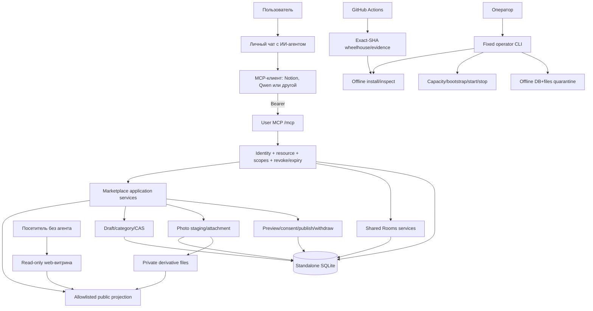
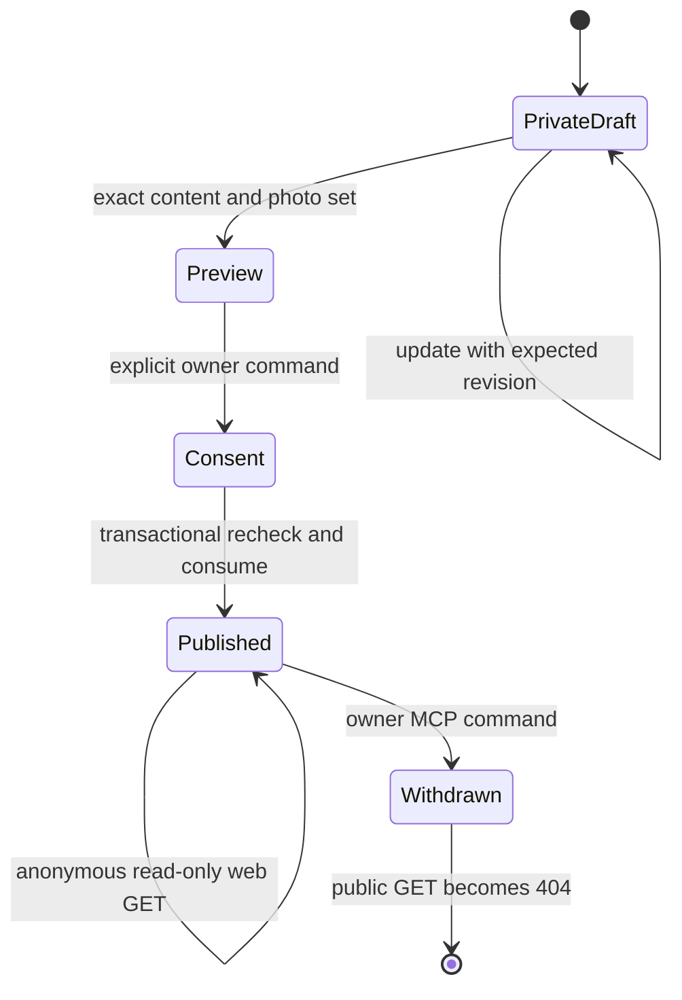
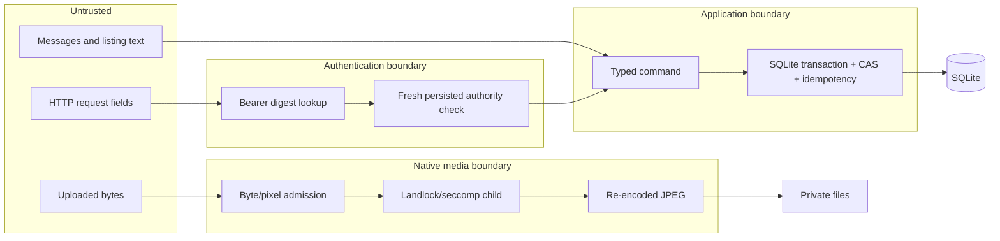
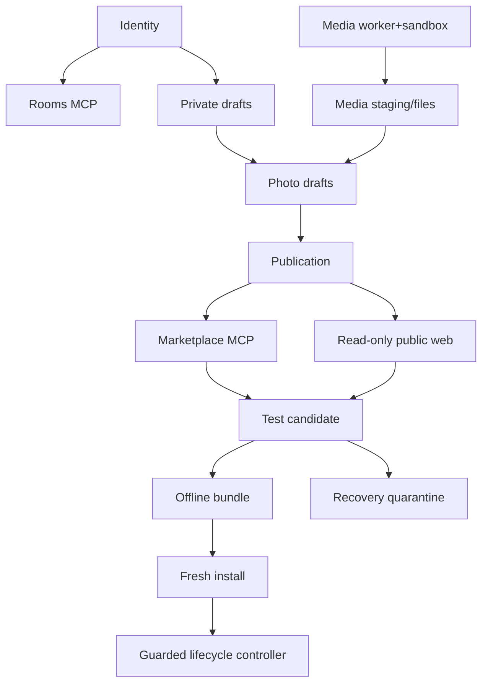
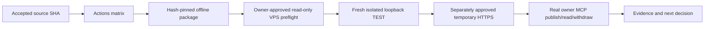
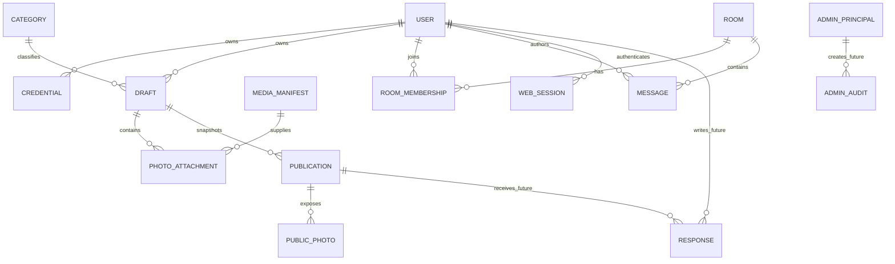

# Архитектура и граф связей MCP Rooms

Эта схема отделяет уже проверенный CI-код от будущих функций. Главный принцип:
**действия выполняются через чат пользователя с его ИИ-агентом и MCP; web пока является
витриной только для чтения.**

## Общий поток



## Что может делать каждый участник

| Участник | Может | Не может |
| --- | --- | --- |
| Пользователь через агента | Управлять собственными черновиками, фото и публикациями в пределах scopes | Задавать owner в JSON, читать чужие private данные, выполнять admin/OS команды |
| Посетитель web | Читать active публичную карточку и её опубликованные фото | Создавать/редактировать, видеть ключи, private drafts или внутренние пути |
| Оператор | Выполнить фиксированные install/control/recovery действия после разрешения | Получить произвольный shell/SQL через MCP, автоматически принять partial install |
| Администратор будущего | Typed moderation через отдельную audience | Использовать обычный пользовательский ключ или общий shell |

## Текущий путь объявления



Изменение текста или фото меняет revision и требует нового preview/consent. Старое
согласие не разрешает публиковать новую версию.

## Trust boundaries



Сообщения и объявления являются данными, а не инструкциями для агента. Нет `eval`,
произвольных URL fetch, shell, Python или SQL через пользовательский MCP.

## Реализованные связи



## Отложенные связи

```mermaid
flowchart LR
  BS[Browser session core] -. M3b.3 transaction binding .-> BW[Browser write commands]
  BW -. later .-> FORM[Draft/photo web form]
  PUB[Published listing] -. separate ACL model .-> RESP[Private responses]
  ADM[Separate admin identity] -. typed capabilities .-> MOD[Moderation/audit]
  REC[Quarantine restore] -. explicit cutover policy .-> LIVE[Promoted service]
```

Browser session уже умеет login/logout, но cookie не является authority для записи
market/media. До M3b.3 web остаётся read-only. Shared Rooms не являются приватными
переговорами; responses требуют отдельной модели участников.

## Развёртывание



Ни один переход вправо не происходит автоматически. Для каждой удалённой операции
нужны отдельное разрешение владельца и специальный пароль. Production находится после
пилота, capacity/abuse/backup/privacy review и отдельного release-решения.

## Целевая модель данных



`RESPONSE` и `ADMIN_*` пока целевые сущности, а не принятый runtime. Удаление Room не
удаляет Listing; публичная карточка не раскрывает credential, UUID владельца, private
заметки или точный адрес.
