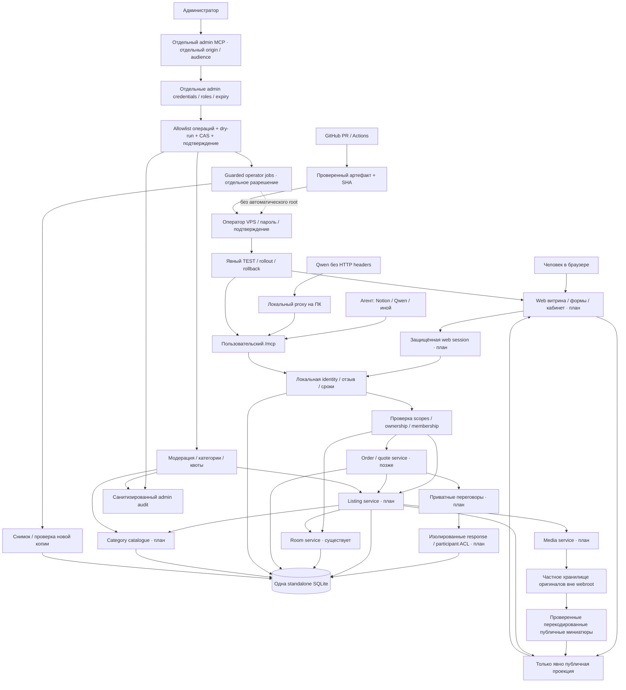
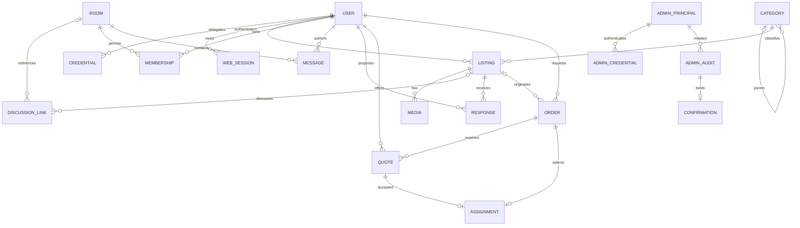

# Граф связей и границ доверия

Текущее направление: [ADR-001 — минимальный собственный Python/SQLite domain](decisions/001-marketplace-foundation.md).
[Общий контракт приёмки](marketplace-conformance.md) описан, но не выполнен.

Проектная схема следующего этапа, не схема уже работающего production.
Связи описаны для запланированных компонентов; только room core/identity/operator CLI
и Qwen adapter реализованы в базовом alpha. Web preview и listing_contract — первый
изолированный шаг, НЕ зарегистрированные публичные API.

## Компоненты и потоки

Публичный web GET не требует секретного ключа и читает только allowlisted public поля.
Права web/MCP проверяются в общем сервисном слое, не только в UI. Admin вход закрыт
по умолчанию, отдельно от публичной регистрации и от старого mcp-server.

## Модель данных — целевая

ER-схема концептуальная: constraints/индексы/транзакции ещё предстоит реализовать.
Приватные данные адресов/контактов в отдельной защищённой проекции заказа, не в public listing.
Связь listing-room НЕ каскад удаления объявления при rooms_close; nullable/unlink.
У admin отдельный principal namespace: пользователь не повышает себя до admin.
ASSIGNMENT: уникальный order_id и CAS версии заказа в одной транзакции; один исполнитель.

## Инвентарь взаимосвязей

| Источник → цель | Контракт и граница |
| --- | --- |
| Браузер → public GET | Нет Bearer; только active/public/not-expired/not-blocked |
| Web session → сервис | Secure/HttpOnly/SameSite; CSRF, отзыв и scopes каждый запрос |
| Агент → /mcp | Индивидуальный Bearer; не токен в arguments/URL |
| /mcp → domain | Проверенный principal; owner не задаётся клиентом |
| Domain → SQLite | Параметры SQL, транзакции, revision CAS, квоты |
| Listing → public view | Allowlist полей; без credentials, точных адресов и внутренних заметок |
| Listing → room | Обсуждение отдельно, права не наследуются по одной ссылке |
| Media → файл | UUID reference, проверка формата/размера, перекодирование; не внешний URL-fetch |
| Admin → admin MCP | Отдельная audience/роль, не обычный пользовательский ключ |
| Admin command → mutation | Capability, reason, target revision, одноразовое подтверждение, audit |
| Operator → VPS | Только ручное согласованное выполнение; никакого remote shell tool |
| Backup → restore | Новая закрытая копия + проверка; revocation rewind reconciliation перед expose |
| Agents → external LLM | Опционально; приватный текст не отправляется без согласия |

## Карта исходников

- Реализовано: src/mcp_rooms/{store,service,identity,enrollment,server,admin,maintenance}.py.
- Начато отдельно: src/mcp_rooms/listing_contract.py — чистые типы/валидация/проекция,
  без SQL, transport, registration и новых scopes у существующих credentials.
- web/prototype/index.html — автономный дизайн-прототип с демо, не live витрина.
- Следующие модули: listing_store/service, web_app/templates, media, admin_server/auth/audit.
- Сейчас НЕ расширять IdentityStore.SCOPES до admin: отдельная модель и issuer/resource.

[Mindmap и этапы](product-mindmap.md) · [Admin boundary](admin-mcp-design.md)
· [Первый тест продажи](first-sale-acceptance.md).
